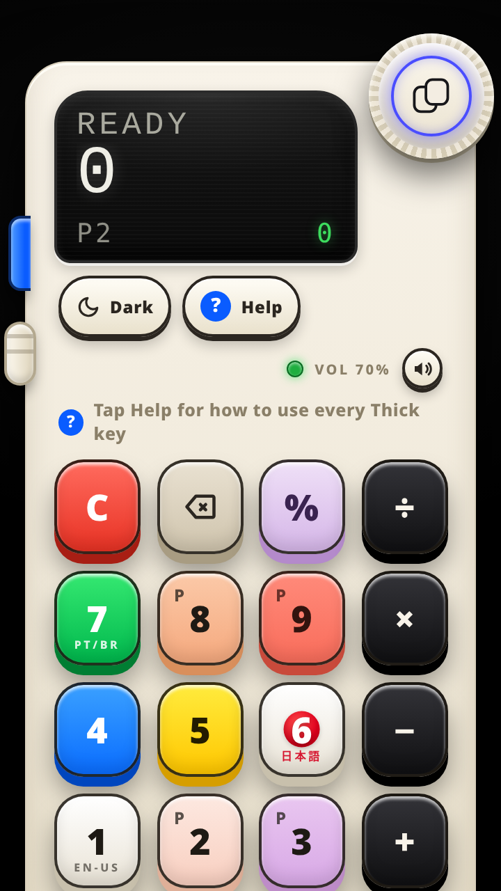

# Thick — The Calculator That Thocks

Thick is a satisfying ASMR calculator. It wins as sound and touch in the first two seconds, not as a calculator. Every key press answers with a synthesized click and a distinct haptic, so doing arithmetic feels like pressing a chunky physical device.

Status: working prototype. Built November 2026. A signed Android APK also exists.

## What it does

- Full calculator on a uniform 4 column grid. Every key is at least 68 px, built for thumbs.
- A synthesized click for every key, generated in the browser with the Web Audio API. Operator keys sound deeper, and equals answers with a chime.
- A distinct haptic pattern for each function, through the Vibration API.
- Dark mode, and an in-app function guide that explains every key.
- Works fully offline. No account, no data collected, nothing leaves the device.

## The design

The interface is modeled on a real chunky device: a cream body, a black pixel display, a blue ring dial, and a green LED. The keypad keeps the pastel keys and the oversized feel of the hardware it is based on.

## How it is built

Thick is a static web app written in TypeScript and shipped as one self-contained page. Sounds are synthesized in code, not audio files. State is kept in local storage on the device.

## Showcase only

This repository is a showcase. It contains no source code and no build files, and nothing here is open source. The screenshot(s) above are showcase images only. See NOTICE.md.

## Contact

Built by Yash Dashrath, Pune, India.

- Email: yashdashrath18@gmail.com
- LinkedIn: https://www.linkedin.com/in/yash-dashrath
- Yash MediaWorks: https://www.linkedin.com/company/yashmediaworks/
